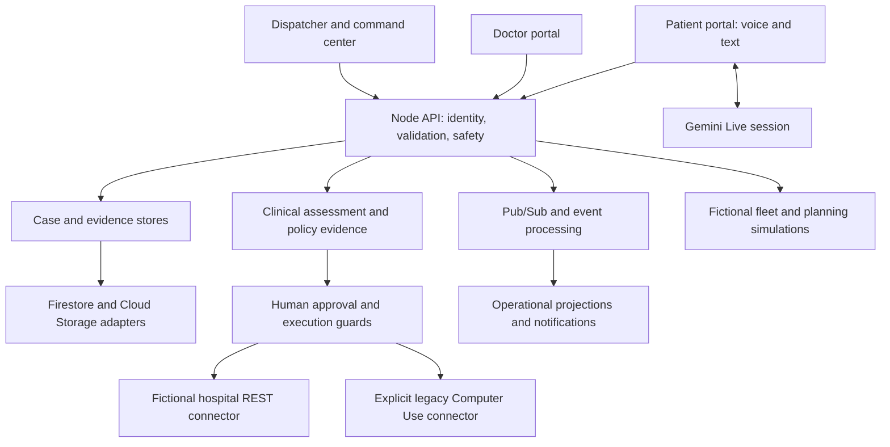

# Architecture and boundaries

The diagram summarizes logical responsibilities; not every arrow is a synchronous HTTP call. Optional cloud components and clinical features are configuration-dependent.

The frontend, API, and clinical runtime are separate source areas. The API is the enforcement boundary for identity, permissions, validated case transitions, approval binding, and connector execution. Browser UI visibility alone is not an authorization mechanism.

Infrastructure source is retained for architectural review, including API contracts used by regression tests. It does not authorize a deployment. Environment-specific plans, state, credentials, import configuration, and deployment runbooks are excluded from this showcase.

Some application constants and bundled policy records contain existing public project/resource identifiers. Identifiers are not credentials. They are retained where changing them would diverge from the reviewed code or break policy provenance; this copy is not configured to operate those resources.

The policy corpus is fictional. Its completion receipt is retained because the runtime bundle test checks exact agreement with that receipt. It is not patient data or an access token.

A [supporting architecture illustration](demo/latest/smartcareops-production-architecture.png) is included. The source and explanation above are the authority for configuration and prototype limitations; an illustration is not proof of deployed service state.
